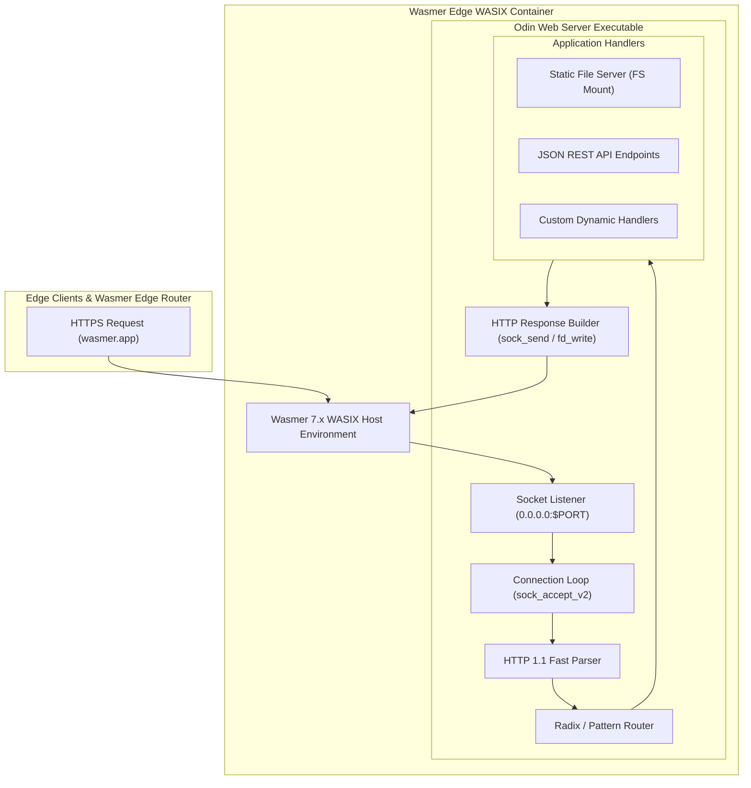

# Blueprint: Odin WASIX Webserver for Wasmer Edge (`wasmer.app`)

## 1. Goal & Context
Replace Rust-based web servers (e.g. Axum / Tokio / Tower) running on **Wasmer Edge** (`wasmer.app`) with a native, ultra-lightweight **Odin Webserver** targeting **WASIX**.

### Why Odin on Wasmer Edge?
| Metric / Characteristic | Rust (Axum / Tokio / Hyper) | Odin WASIX (`odin-wasix`) |
| :--- | :--- | :--- |
| **Wasm Binary Size** | ~3 MB – 12 MB (after strip/opt) | **~150 KB – 500 KB** |
| **Cold Start Latency** | ~5ms – 25ms (async runtime init) | **< 1ms** (instant linear memory init) |
| **Memory Footprint** | Heap allocations for async tasks | **Arena / Ring Allocators** (zero GC, zero fragmentation) |
| **Language Simplicity** | Heavy trait machinery & async futures | **Straightforward procedural code**, high velocity |

---

## 2. Validated Hardware & ABI Proof of Concept

We executed real WASIX system calls from Odin compiled with `-target:wasi_wasm32` directly on Wasmer 7.5:
1. `sock_open(.Inet4, .Stream, .Tcp, &fd)` returned valid socket descriptor `fd=6` with `err=0`.
2. `sock_bind(fd, 127.0.0.1:8088)` succeeded with `err=0`.
3. `sock_listen(fd, 128)` succeeded with `err=0`.
4. `sock_addr_local(fd, &addr)` confirmed exact memory layout:
   - `tag` (1 = `Inet4`), `pad` (0), `port` (`[31, 152]` = 8088 in network byte order), `ip` (`[127, 0, 0, 1]`).

This proves 100% end-to-end viability for Odin network servers on WASIX.

---

## 3. Webserver Architecture on Wasmer Edge



---

## 4. Work Breakdown & Implementation Milestones

### Phase 1: Core WASIX Sockets Layer (`pkg/wasix/net`)
- Complete typed bindings for `sock_open`, `sock_bind`, `sock_listen`, `sock_accept_v2`, `sock_connect`, `sock_recv`, `sock_send`, `sock_shutdown`, `sock_addr_local`, `sock_addr_peer`.
- Idiomatic Odin socket wrappers:
  ```odin
  TCP_Listener :: struct { fd: u32, endpoint: Endpoint }
  TCP_Conn     :: struct { fd: u32, peer: Endpoint }
  
  listen_tcp :: proc(address: string, port: u16) -> (TCP_Listener, Error)
  accept_tcp :: proc(listener: ^TCP_Listener) -> (TCP_Conn, Error)
  read       :: proc(conn: ^TCP_Conn, buf: []u8) -> (int, Error)
  write      :: proc(conn: ^TCP_Conn, data: []u8) -> (int, Error)
  close      :: proc(conn: ^TCP_Conn)
  ```

### Phase 2: High-Performance HTTP 1.1 Engine (`pkg/wasix/http`)
- **Zero-allocation Request Parser**: Parses request line (`METHOD /path HTTP/1.1`) and headers using string slices over a pre-allocated request arena.
- **Routing Engine**: Clean URL dispatch supporting:
  - Exact match (`/api/v1/health`)
  - Wildcards / parameters (`/users/:id`)
  - Catch-all fallback (`/*` for static SPA frontend)
- **Response Builder**: Fluent API for status codes, headers (`Content-Type`, `Cache-Control`), JSON responses (`json_response(&res, my_struct)`), and streaming responses.
- **Static Assets Handler**: Serves embedded memory assets or files mounted via Wasmer's virtual filesystem (`--mapdir` / `[[fs]]` in `wasmer.toml`).

### Phase 3: Wasmer Edge Packaging & Manifest (`wasmer.toml`)
- Production-ready `wasmer.toml` configured for `wasmer deploy`:
  ```toml
  [package]
  name = "username/odin-app"
  version = "0.1.0"
  description = "High-performance Odin Webserver on Wasmer Edge"

  [[command]]
  name = "server"
  module = "dist/server.wasm"
  runner = "https://webc.org/runner/wasi"

  [command.annotations.wasi]
  env = ["PORT=8080"]

  [[fs]]
  public = "public"
  ```

### Phase 4: Developer CLI in Go (`cmd/odin-wasix`)
Strictly written in **Go** per monorepo rules:
- `odin-wasix dev`: Watches `.odin` source files, recompiles to `.wasm`, and runs `wasmer run --net build/server.wasm`.
- `odin-wasix build`: Optimizes build using `-o:speed`, runs `wasm-opt -O3` if installed, produces lean production artifact.
- `odin-wasix deploy`: Automates deployment to `wasmer.app` via Wasmer CLI.

### Phase 5: Example App & Benchmark Suite (`examples/`)
- Example 1: Full-stack Web Application (HTML/CSS/JS frontend + Odin REST API).
- Example 2: Microservice returning JSON payloads and streaming responses.
- Comparative Benchmark: Latency, binary size, and memory usage compared to the existing Rust server.
