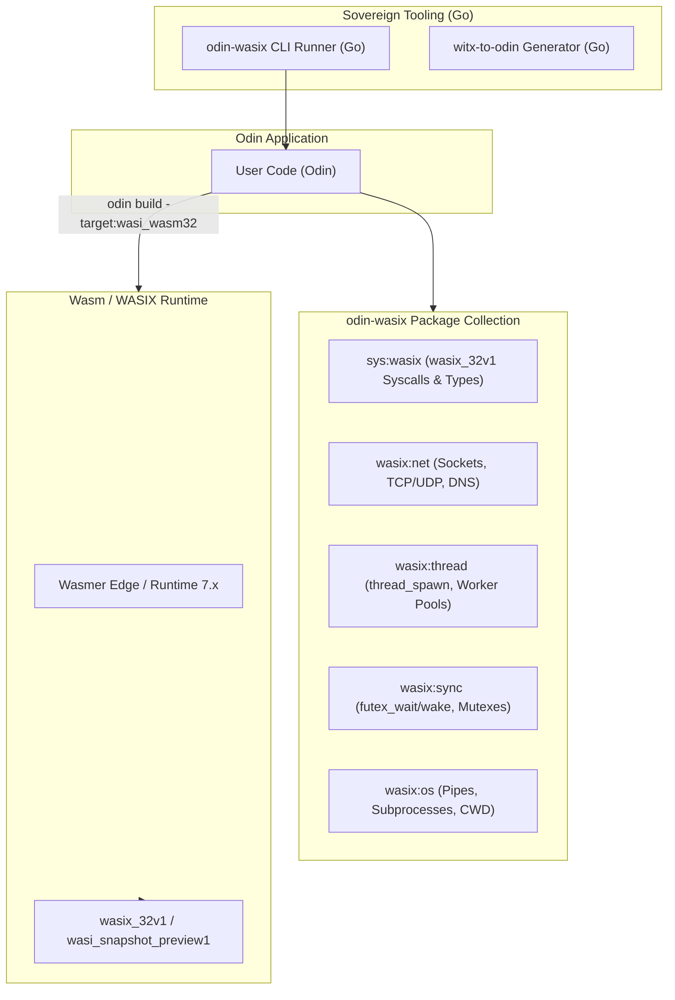

# Architectural Plan: First-Class WASIX Support for the Odin Programming Language

## 1. Executive Summary & Objective

**WASIX** ([wasix.org](https://wasix.org/)) is an extension and superset of the standard WASI (WebAssembly System Interface) Preview 1 ABI. While standard WASI (`wasi_snapshot_preview1`) is restricted to basic file I/O, clocks, and environment arguments, WASIX introduces full POSIX-grade capabilities:
- **Berkeley Sockets & Networking** (`sock_open`, `sock_bind`, `sock_listen`, `sock_accept`, `sock_connect`, `sock_send`, `sock_recv`)
- **Multithreading & Futex Synchronization** (`thread_spawn`, `thread_join`, `futex_wait`, `futex_wake`)
- **Process & Subprocess Control** (`proc_fork`, `proc_exec`, `proc_spawn`, `proc_wait`, `proc_id`, `pipe`)
- **System Environment Enhancements** (`chdir`, `getcwd`, `tty_get`, `tty_set`, `epoll`)

While C/C++ (via `wasix-libc`) and Rust (via `cargo-wasix` and standard library patches) have first-class WASIX support, **Odin** currently treats all WASI targets as strictly Preview 1:
- `core:net` returns `.Network_Unreachable` for all socket procedures.
- `core:thread` panics with `unimplemented("core:thread procedure not supported on target")`.
- `core:os` stubs out process spawning, process inspection, and directory switching.

Our mission is to build **`odin-wasix`**: a complete, zero-dependency, sovereign integration layer providing full WASIX capabilities to Odin programs.

---

## 2. Technical Feasibility & Discovery Validation

Because Odin's WebAssembly backend emits standard WASM object files and invokes LLVM's `wasm-ld` with `--allow-undefined`, Odin can link against any foreign ABI at compile time without requiring compiler-level C ABI shims.

We verified this on the active system:
```odin
foreign import wasix "wasix_32v1"

@(default_calling_convention="contextless")
foreign wasix {
    proc_id            :: proc(pid: ^u32) -> u16 ---
    thread_parallelism :: proc(parallelism: ^uint) -> u16 ---
}
```
When compiled with `odin build ... -target:wasi_wasm32` and executed under `wasmer run`, Wasmer successfully resolved the `wasix_32v1` symbols, executing `proc_id` (PID 1) and `thread_parallelism` (10 cores) with return code `0`.

---

## 3. System Architecture & Component Design



---

## 4. Multi-Phase Implementation Roadmap

### Phase 1: Complete WASIX System Call & ABI Specification (`sys/wasix`)
- **Goal**: Provide 100% complete, strongly-typed Odin bindings for all WASIX Preview 1 extensions under module namespace `"wasix_32v1"` (and optional `"wasix_64v1"`).
- **Deliverables**:
  - `types.odin`: Definition of all WASIX types (`addr_port_t`, `ip_addr_t`, `sock_type_t`, `sock_proto_t`, `fdflags_t`, `errno_t`, `futex_t`, `tid_t`, `pid_t`, etc.).
  - `wasix_api.odin`: Foreign declarations matching the official `wasix-witx` specification.
  - Automatic validation generator written in **Go** (`generator/gen_bindings.go`) that parses `wasix-witx` definitions and maintains parity with upstream `wasix.org`.

### Phase 2: WASIX Networking Subsystem (`net/`)
- **Goal**: Full BSD-compatible networking in Odin running on WASIX.
- **Deliverables**:
  - TCP client and server (`dial_tcp`, `listen_tcp`, `accept_tcp`).
  - UDP sockets (`send_udp`, `recv_udp`).
  - Socket option configuration (timeouts, reuse address, keepalive).
  - DNS resolution using WASIX `resolve`.
  - HTTP 1.1 minimal server and client demonstration.

### Phase 3: WASIX Threading & Concurrency Subsystem (`thread/`, `sync/`)
- **Goal**: Preemptive and cooperative multithreading using WASIX primitives.
- **Deliverables**:
  - `thread_spawn`: Spawning worker threads with stack allocation.
  - Futex-based synchronization: Fast user-space mutexes, semaphores, and condition variables (`futex_wait`, `futex_wake`, `futex_wake_all`).
  - Thread pool and parallel task execution runner.

### Phase 4: WASIX Process, Pipe & OS Subsystem (`os/`)
- **Goal**: Subprocess spawning and system environment control.
- **Deliverables**:
  - Current directory manipulation: `chdir`, `getcwd`.
  - Piping and IPC: `fd_pipe`, `fd_dup`.
  - Subprocess spawning and status inspection: `proc_spawn`, `proc_wait`, `proc_signal`.

### Phase 5: Developer CLI & Workflow Runner (`cmd/odin-wasix`)
- **Goal**: Zero-friction developer CLI tool (written in Go) mirroring `cargo-wasix`.
- **Deliverables**:
  - `odin-wasix build`: Wraps `odin build` with target `-target:wasi_wasm32`, appropriate `-target-features:+atomics,+bulk-memory` (when threading is active), and auto-injected package collections.
  - `odin-wasix run`: Builds and immediately invokes `wasmer run --net <wasm_file>`.
  - `odin-wasix test`: Runs all unit and integration test suites.

### Phase 6: Documentation, README, and Upstream Integration Proposal
- **Goal**: Complete project documentation and upstream proposal.
- **Deliverables**:
  - Full `README.md` with usage instructions, architecture details, and sample code.
  - A comprehensive patch / RFC document detailing how this layer can be upstreamed into Odin's `core:sys/wasm/wasix`, `core:net`, and `core:thread`.

---

## 5. Invariants & Guardrails Compliance

1. **Go Scripts Only**: All build automation, codegen scripts, and CLI tooling will be implemented strictly in **Go** (zero Python).
2. **README for the Project**: Full, exhaustive `README.md` covering architecture, installation, API references, and benchmarks.
3. **Atomic Git Commits**: Commits created following Conventional Commits (`feat:`, `chore:`, `docs:`) upon completion.
4. **Zero-Telemetry & Sovereignty**: All code executes 100% locally with Wasmer runtime and local test harnesses.
