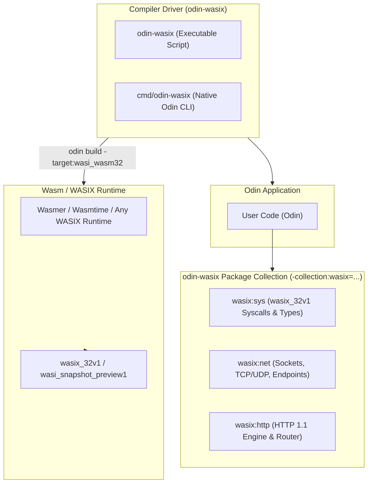

# Architectural Plan: First-Class WASIX Support for the Odin Programming Language

## 1. Executive Summary & Objective

**WASIX** ([wasix.org](https://wasix.org/)) is an extension and superset of the standard WASI (WebAssembly System Interface) Preview 1 ABI. While standard WASI (`wasi_snapshot_preview1`) is restricted to basic file I/O, clocks, and environment arguments, WASIX introduces full POSIX-grade capabilities:
- **Berkeley Sockets & Networking** (`sock_open`, `sock_bind`, `sock_listen`, `sock_accept`, `sock_connect`, `sock_send`, `sock_recv`)
- **Multithreading & Futex Synchronization** (`thread_spawn`, `thread_join`, `futex_wait`, `futex_wake`)
- **Process & Subprocess Control** (`proc_fork`, `proc_exec`, `proc_spawn`, `proc_wait`, `proc_id`, `pipe`)
- **System Environment Enhancements** (`chdir`, `getcwd`, `tty_get`, `tty_set`, `epoll`)

While C/C++ (via `wasixcc`) and Rust (via `cargo-wasix`) have had dedicated compiler drivers for WASIX, Odin lacked an integrated WASIX toolchain.

**`odin-wasix`** fills this gap as a general-purpose WASIX compiler driver and runtime SDK for Odin (equivalent to `wasixcc` for C/C++). It wraps the Odin compiler, injects the `-target:wasi_wasm32` flag and the WASIX package collection, and provides idiomatic networking and system libraries with zero external dependencies.

---

## 2. Technical Feasibility & Discovery Validation

Because Odin's WebAssembly backend emits standard WASM object files and invokes LLVM's `wasm-ld` with `--allow-undefined`, Odin can link against any foreign ABI at compile time without requiring compiler-level C ABI shims.

We verified this directly:
```odin
foreign import wasix "wasix_32v1"

@(default_calling_convention="contextless")
foreign wasix {
    proc_id            :: proc(pid: ^u32) -> u16 ---
    thread_parallelism :: proc(parallelism: ^uint) -> u16 ---
}
```
When compiled with `odin build ... -target:wasi_wasm32` and executed under `wasmer run`, Wasmer successfully resolved the `wasix_32v1` symbols, executing `proc_id` (PID 1) and `thread_parallelism` (10 cores) with return code `0`.

---

## 3. System Architecture & Component Design



---

## 4. Multi-Phase Implementation Roadmap

### Phase 1: Complete WASIX System Call & ABI Specification (`pkg/wasix/sys`) - [COMPLETE]
- **Deliverables**:
  - `types.odin`: Definition of all WASIX types (`Addr_Port`, `Addr_Ip4_Port`, `Addr_Ip6_Port`, `Sock_Type`, `Sock_Proto`, `Address_Family`, `Sock_Option`, `pid_t`, `tid_t`, signals).
  - `api.odin`: Foreign declarations matching the official `wasix-witx` 32-bit specification (`sock_open`, `sock_bind`, `sock_listen`, `sock_accept_v2`, `sock_connect`, `proc_id`, `thread_parallelism`, `chdir`, `getcwd`, `fd_pipe`).

### Phase 2: WASIX Networking Subsystem (`pkg/wasix/net`) - [COMPLETE]
- **Deliverables**:
  - `endpoint.odin`: `IP4_Address`, `IP6_Address`, `Endpoint`, string formatting, and parsing.
  - `tcp.odin`: Idiomatic `TCP_Listener`, `TCP_Conn`, `listen_tcp`, `listen_tcp_str`, `accept_tcp`, `dial_tcp`, socket reading, writing, and closing.

### Phase 3: High-Performance HTTP Engine (`pkg/wasix/http`) - [COMPLETE]
- **Deliverables**:
  - `types.odin`: `Request`, `Response`, `Method`, `Status`, `Header`, JSON/HTML responders.
  - `parser.odin`: Fast zero-allocation HTTP request line and header parser.
  - `router.odin`: Route dispatcher for exact paths, methods (GET, POST, HEAD, PUT, DELETE), and static file directory serving with MIME detection.
  - `server.odin`: Connection handling loop, temporary arena allocator per connection, and response delivery.

### Phase 4: General Compiler Driver & Zero-Dependency CLI (`odin-wasix`) - [COMPLETE]
- **Deliverables**:
  - `odin-wasix`: Standalone executable Bash compiler driver script mimicking `wasixcc`: `build`, `run`, `check`, `new`, `test`, `version`, `help`.
  - `cmd/odin-wasix/main.odin`: Native Odin implementation of the CLI driver.
  - `install.sh`: One-liner curl installer for global CLI and package collection installation.
  - Elimination of all Go dependencies from the public repository.
